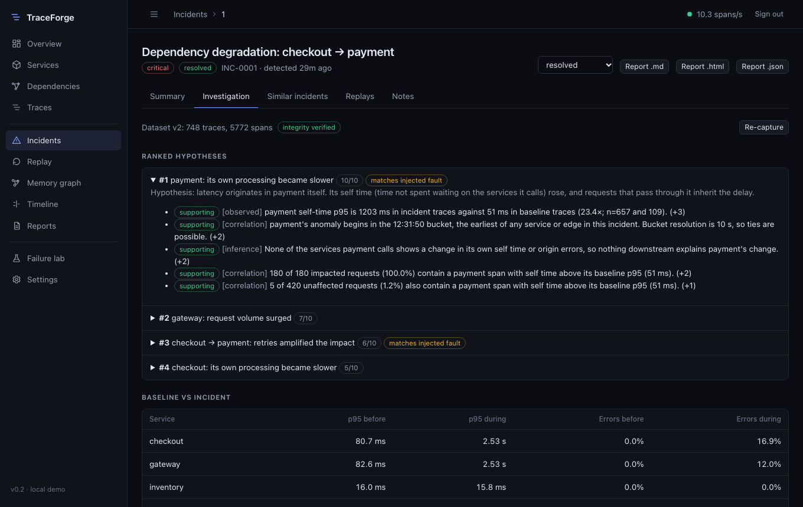
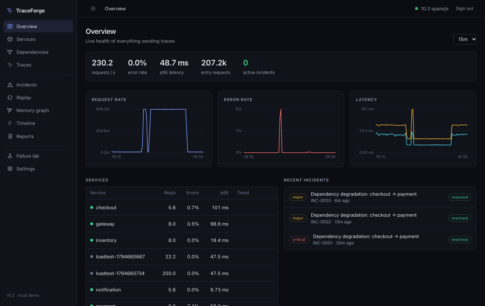
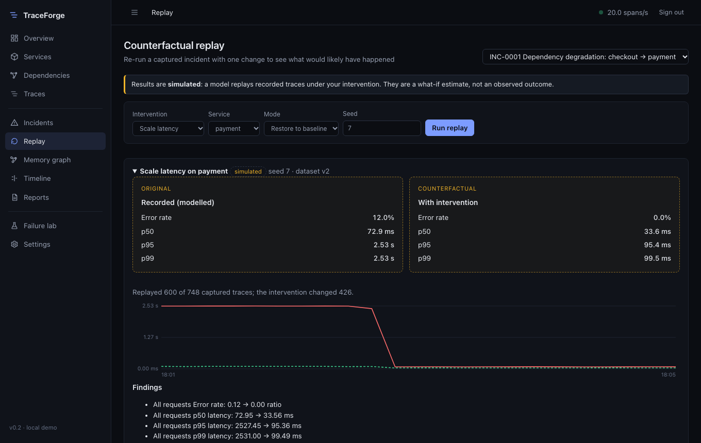
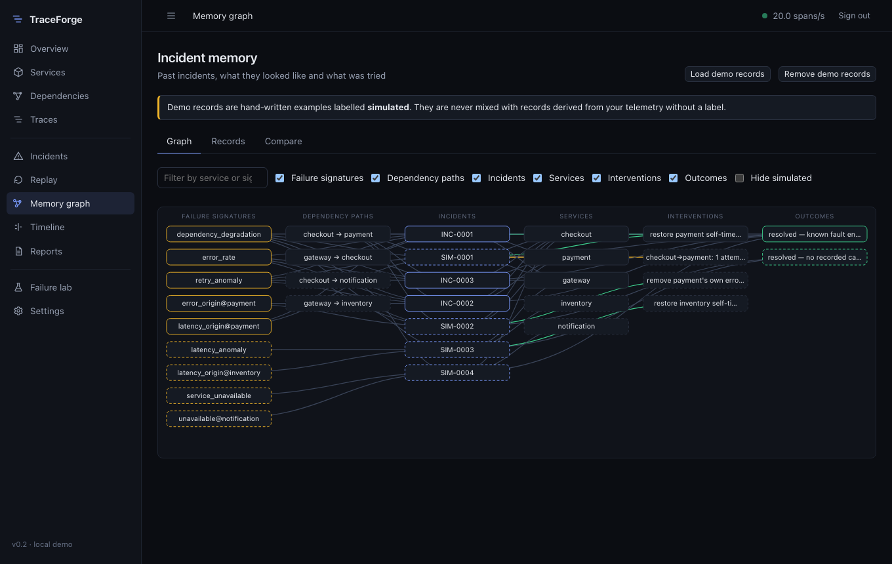
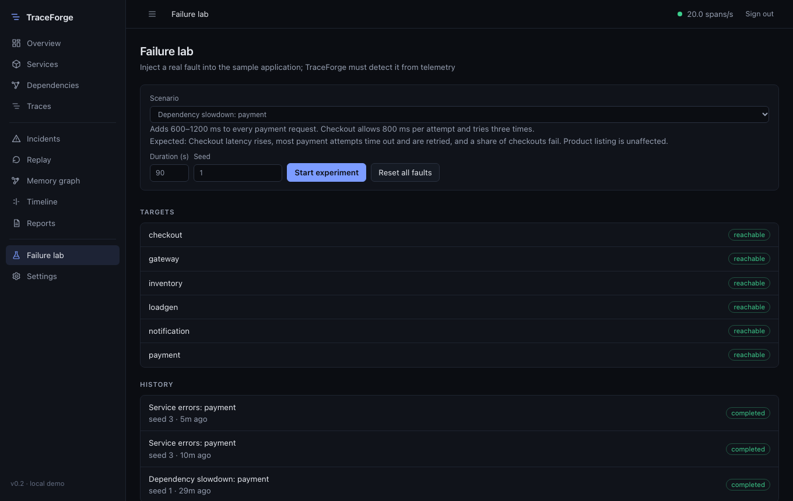

# TraceForge

TraceForge ingests OpenTelemetry traces (OTLP/HTTP), detects service degradation, builds an evidence-ranked
investigation for each incident, remembers past incidents, and replays captured traces with one change applied
("what if payment latency were at baseline?") to estimate the effect. A bundled sample shop and failure lab let you
reproduce incidents on demand.

> **Local demonstration. Not production-ready.** See [Security](docs/SECURITY.md) and [Limitations](docs/LIMITATIONS.md).



| | |
|---|---|
|  |  |
|  |  |

## Quick start

Requires Docker with Compose. The tokens below are **public demonstration values**, not secrets.

```sh
export TF_API_TOKEN=demo-api-token-123 TF_LAB_TOKEN=demo-lab-token-456
docker compose -f deploy/docker-compose.yml up --build -d
```

Open <http://localhost:8080>, enter the API token, then follow [docs/DEMO.md](docs/DEMO.md): run the payment slowdown in
**Failure lab**, open the incident, review the ranked hypotheses, replay a fix, download the report.
Point your own OTLP/HTTP exporter at `http://localhost:4318/v1/traces`.

## Configuration

| Variable | Default | Purpose |
|---|---|---|
| `TF_DATABASE_URL` | required | PostgreSQL URL |
| `TF_HTTP_ADDR` / `TF_OTLP_ADDR` | `:8080` / `:4318` | API+UI and OTLP listeners |
| `TF_API_TOKEN` | unset (open) | Bearer token required on `/api` |
| `TF_INGEST_TOKEN` | unset | Bearer token required on OTLP ingest |
| `TF_LAB_TOKEN` | unset | Token the sample services require for fault injection |
| `TF_LAB_TARGETS` | unset (lab off) | `name=url,...` allow-list of services the lab may fault |
| `TF_RETENTION_HOURS` | `24` | Telemetry retention |
| `TF_DETECT_INTERVAL_SECONDS` | `10` | Detection cadence |
| `TF_INGEST_MAX_QUEUED_SPANS` | `50000` | Backpressure bound (HTTP 429 beyond it) |
| `TF_WEB_DIR` | `web/dist` | Static UI directory |
| `TF_LOG_LEVEL` / `TF_LOG_FORMAT` | `info` / `json` | Logging |

## Development

```sh
go vet ./... && go test ./...                 # backend (Postgres tests need TF_TEST_DATABASE_URL, see docs/TESTING.md)
cd web && npm ci && npm test && npm run build # frontend unit tests, typecheck, production build into web/dist
cd web && npm run e2e                         # Playwright against a running stack
scripts/e2e.sh                                # API acceptance run (~6 min)
scripts/reliability.sh                        # separate reliability run
```

`web/dist` is committed because the Docker image copies it; rebuild it after changing `web/src`.

## Documentation

[Architecture](docs/ARCHITECTURE.md) · [Incident Memory](docs/MEMORY_GRAPH.md) · [Testing](docs/TESTING.md) ·
[Reliability](docs/RELIABILITY.md) · [Security](docs/SECURITY.md) · [Limitations](docs/LIMITATIONS.md) ·
[Demo](docs/DEMO.md) · [Project status](PROJECT_STATUS.md)
